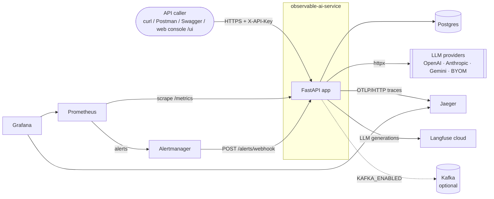
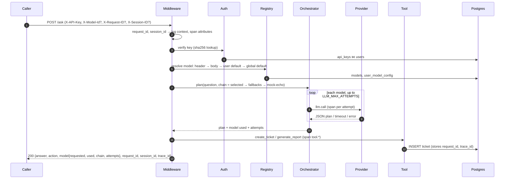
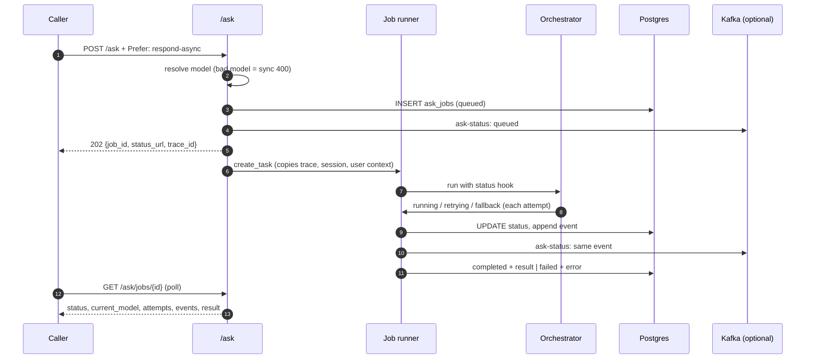
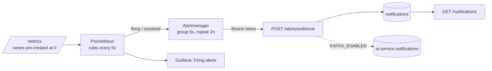
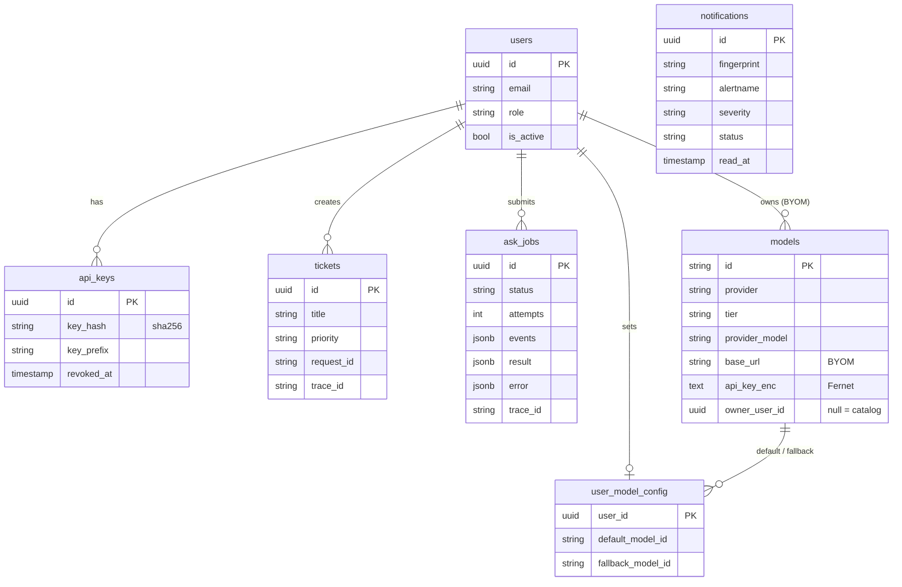

# High-level design: observable-ai-service

## 1. Purpose and scope

An AI-backed REST service built to be **operated and debugged in production**. Callers ask
questions; an LLM-planned agent answers and can run two business actions (create a support
ticket, build an order report). Every request is traceable end to end, failures degrade
instead of erroring, and the service tells its operators when something is wrong.

In scope: the API, the LLM orchestrator, persistence, observability (logs, metrics, traces,
LLM traces), alerting with in-app notifications, async jobs, optional Kafka fan-out, local
deployment with Docker or Podman. Out of scope: UI, multi-tenancy, production secret
management, horizontal scaling.

## 2. System context

## 3. Components

| Component | Responsibility | Tech | Port |
|---|---|---|---|
| API | Auth, `/ask`, tickets, models, jobs, notifications, health, metrics | FastAPI, uvicorn, Python 3.12 | 8000 |
| Web console ([guide](web-console.md)) | `/ui`: Authorize, auth state, theme, request builder, panels, request log | static HTML/CSS/JS served by the app (no build) | 8000 |
| Middleware | Request/session ids, access log, RED metrics, OTel server span, console security headers | raw ASGI | – |
| Agent | JSON plan from the LLM, then a tool | `app/services/agent.py` | – |
| LLM orchestrator | Model resolution, retries, fallback chain, per-attempt spans | `app/llm/*`, httpx, tenacity | – |
| Job runner | Background async `/ask`, status hook, recovery | asyncio tasks | – |
| Event publisher | Optional fan-out of job status and alerts | aiokafka (flagged) | – |
| Postgres | Users, keys, models, user config, tickets, notifications, jobs | Postgres 16, SQLAlchemy async, Alembic | 5433 |
| Jaeger | Trace storage and UI | all-in-one, in-memory | 16686, 4318 |
| Prometheus | Scrape, store, evaluate alert rules | v2.55 | 9090 |
| Alertmanager | Group, route and resolve alerts to the app | v0.27 | 9093 |
| Grafana | Dashboard (generated from code), Explore | v11 | 3000 |
| Langfuse | Prompt, output, tokens per LLM call; sessions; users | cloud | – |
| Kafka + UI | Topics `ai-service.ask-status`, `ai-service.notifications` | apache/kafka KRaft, kafka-ui (profile `kafka`) | 9094, 8080 |

## 4. Key flows

### 4.1 Synchronous `/ask`

### 4.2 Async `/ask` (`Prefer: respond-async`)

### 4.3 Alerting

| Rule | Condition | Severity |
|---|---|---|
| `Http5xxErrors` | any 5xx on a route in the last minute | critical |
| `Http4xxAuthErrors` | any 401/403 in the last minute (no other 4xx alerts) | warning |
| `HighErrorRate` | 5xx ratio > 5% over 5 min, with traffic | critical |
| `LlmFallbacks` | any fallback hop in 2 min | warning |
| `AskLatencyHigh` | `/ask` p95 > 3 s for 1 min | warning |
| `AskJobsFailing` | any failed async job in 5 min | warning |
| `ServiceDown` | `up == 0` for 30 s | critical |

## 5. Data model

Migrations: `0001` schema, `0002` ticket ids → UUID (reversible), `0003` notifications, `0004`
ask_jobs.

## 6. LLM orchestration

- **Catalog**: 3 tiers × OpenAI / Anthropic / Gemini, plus mocks (`mock-economy`, `-standard`,
  `-premium`, `mock-echo`) and per-user bring-your-own OpenAI-compatible models.
- **Selection**: `X-Model-Id` → body `model_id` → user default → global default. An explicit
  model that is unknown or has no key is a 400. A default that cannot run degrades silently.
- **Chain**: selected → user fallback → `LLM_FALLBACK_CHAIN` → `mock-echo`, deduplicated, with
  `mock-echo` only ever last.
- **Retries**: transient errors (timeout, 429, 5xx, network) are retried with jittered
  exponential backoff; permanent ones (400/401/403, refusal, bad output) move to the next model.
- **Providers** speak raw HTTP through one shared `httpx` client: one timeout policy, one error
  taxonomy, and an HTTP span per call.
- **Fault injection** (`X-Debug-Fault`, `X-Debug-Fault-Count`) only with
  `ENABLE_FAULT_INJECTION=true`, and never on the last resort.

## 7. Observability design

| Concern | Design |
|---|---|
| Correlation | `request_id` (per request), `session_id` (`X-Session-ID`, default request id), `trace_id` (W3C, honours `traceparent`), `user_id`, `job_id`: on every log line, on spans, in responses, on tickets and jobs |
| Logs | structlog JSON on stdout; one access line per request; secrets redacted; warn/error levels by outcome |
| Metrics | Prometheus, custom registry; RED per route template; LLM attempts, latency, tokens, retries, fallbacks; selection source; tools; tickets; auth failures; jobs; Kafka; alerts; process/GC. Bounded labels only; all bounded series pre-created at 0 |
| Traces | OpenTelemetry → OTLP → Jaeger; spans: server, `model.resolve`, `agent.plan`, `llm.call` ×attempts, `tool.*`, `ask.job`, httpx, SQL |
| LLM traces | Langfuse: one `ask` / `ask.job` trace per request with user, session, tags; one generation per attempt; same trace id as Jaeger |
| Dashboard | `deploy/grafana/build_dashboard.py` → JSON; a test asserts every metric family is on it |

## 8. Security

- API keys: 256-bit random, stored as SHA-256; only a 10-character prefix is ever logged.
- BYOM provider keys: Fernet-encrypted at rest (`APP_ENCRYPTION_KEY`), never returned.
- Alert webhook: separate bearer token, constant-time compare; not a user key.
- Request ids and session ids are validated (`[A-Za-z0-9._:-]{1,128}`) against log injection.
- Errors never echo internals; 500s carry only the request id.
- Fault injection is off by default.
- Roles: `user` and `admin`; `/admin/*` requires admin and returns 403 otherwise.
- The console sends the key only to its own origin; strict CSP (`default-src 'self'`), no
  inline script, no third-party assets; the key lives in `sessionStorage` unless remembered.

## 9. Deployment

`docker-compose.yml` (Docker or Podman; the Makefile detects either):

- default: `app`, `postgres`, `jaeger`, `prometheus`, `alertmanager`, `grafana`
- profile `kafka`: `kafka`, `kafka-ui`

The app container runs migrations on start. Prometheus and Alertmanager reach the app through
`host.docker.internal:8000`, so the same config works for `make up` and for `make dev`. CI
(GitHub Actions) runs lint, type check, tests with an 80% coverage gate, and an image build.

## 10. Failure modes

| Failure | Behaviour | Signal |
|---|---|---|
| LLM provider slow or down | retries, then the next model, finally `mock-echo`; user still answered | `llm_retries_total`, `llm_fallbacks_total`, `LlmFallbacks`, red `llm.call` spans |
| Tool fails | 502 `TOOL_FAILED`; no partial ticket | `Http5xxErrors`, red `tool.*` span, ERROR log |
| Postgres down | readiness 503, protected routes 500, liveness still 200 | `Http5xxErrors`, readiness, `HighErrorRate` |
| App down | — | `ServiceDown` (Prometheus side; the webhook is down too, so check Alertmanager) |
| Kafka down / flag off | publish dropped and counted; API unaffected | `kafka_publish_total{outcome="error"}`, readiness `checks.kafka` |
| Langfuse unreachable | generations dropped; API unaffected | debug log |
| App restarts mid-job | job marked `failed: INTERRUPTED` on next start | `AskJobsFailing` |
| Bad caller input | 4xx with stable code; no LLM cost | `ask_errors_total{code}`, logs (401/403 also alert) |

## 11. Key decisions

| Decision | Why | Cost |
|---|---|---|
| Own orchestrator over raw HTTP | one retry/timeout/error policy for every vendor; HTTP spans for free | an adapter per vendor |
| JSON plan instead of native tool calling | works on every provider, BYOM and the mock | less structured than native tools |
| Span per LLM attempt | shows "3 timeouts, then fallback" instead of one long bar | a few more spans per request |
| Pre-created series | first event is visible to `rate()`/`increase()` | more series at startup (bounded) |
| Alertmanager → webhook → Postgres | in-app notifications with no new infra; resolves handled for us | single consumer |
| Postgres as source of truth, Kafka optional | the API never depends on the broker | at-most-once fan-out |
| In-process job runner | simple for one replica | jobs do not survive a restart; no cross-replica work sharing |
| Dashboard as code | reviewable, testable coverage of every metric | regenerate after edits (`make dashboard`) |

## 12. Evolution

- Multiple replicas: move jobs to a Kafka consumer group; add an idempotency key on `/ask`.
- Trace sampling: keep all error traces, sample a fraction of the rest.
- Notifications: per-user subscriptions; Slack/email receivers in Alertmanager.
- Secrets from a vault instead of `.env`.
