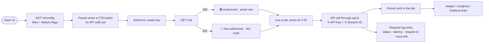

# Web console (`/ui`)

A lightweight console for exercising the API without writing curls. The app serves it itself
(plain HTML, CSS and JavaScript, no build step, no CDN), so it works offline and ships in the
same image.

Open **<http://localhost:8000/ui>**; `http://localhost:8000/` redirects there.

## 1. How it works

- **Nothing loads by itself.** On open, the console reads only `/ui/config`, which holds links
  and flags, not API data. Every tab starts with a button that makes its first call.
- **One wrapper for every call** (`js/api.js`). It adds `X-API-Key` (unless the call overrides
  it) and `X-Session-ID`, times the call, and appends it to the request log.
- **Same origin.** The console calls the API on the same host and port, so there is no CORS and
  the key is never sent anywhere else.

## 2. Routes

### Served for the console

| Route | Auth | Returns |
|---|---|---|
| `GET /` | – | 307 → `/ui/` |
| `GET /ui/` | – | `index.html` (the console) |
| `GET /ui/app.css`, `/ui/js/*.js` | – | static assets |
| `GET /ui/config` | – | `{version, environment, fault_injection, kafka_enabled, links{swagger, grafana, jaeger, prometheus, alertmanager, kafka_ui, langfuse}}`. Public, no secrets. The Langfuse project URL is looked up server-side once. |

Every `/ui` response carries `Content-Security-Policy: default-src 'self'` (no inline script,
no third-party assets), `X-Content-Type-Options: nosniff`, `Referrer-Policy: no-referrer` and
`Cache-Control: no-cache` (revalidate, so a new build shows at once). Static files are not
traced and are logged only at DEBUG.

### API routes the console uses

| Route | Used by |
|---|---|
| `GET /me` | header auth pill, *Routes & auth* |
| `GET /health`, `GET /health/ready` | *Status*, *Routes & auth* |
| `POST /ask`, `GET /ask/jobs/{id}` | *Ask* (sync and async) |
| `GET /models`, `PUT /models/default`, `PUT /models/fallback`, `POST /models/custom`, `DELETE /models/custom/{id}` | *Models*, *Ask* (model dropdown) |
| `GET /tickets`, `GET /tickets/{id}` | *Tickets*, *Routes & auth* |
| `GET /notifications`, `POST /notifications/{id}/read` | *Notifications* |
| `GET /admin/users` | *Routes & auth* (403 / 200) |
| `POST /alerts/webhook` | *Routes & auth* (401 with a wrong token) |

## 3. Header

| Control | What it does | API |
|---|---|---|
| **Session** field | Value sent as `X-Session-ID` on every call (default `ui-<random>`, kept for the tab). Groups this console's calls in logs, Jaeger (`session.id`) and Langfuse Sessions. | – |
| **Theme** toggle | Cycles **◐ System → ☀ Light → ☾ Dark**. *System* follows the OS. The choice is saved per device (`localStorage`) and applied before the first paint, so the page never flashes. | – |
| **Auth pill** | ⚪ *No key* · 🟡 *Key set · not checked* (a stored key, not yet verified) · 🟢 *Authorized · email (role)* · 🔴 *Not authorized · 401 code*. Click it to re-check. Turns red when a later call with your key gets 401. | `GET /me` |
| **Authorize** | Dialog to paste `X-API-Key` (`SEED_DEMO_API_KEY` for a user, `SEED_ADMIN_API_KEY` for an admin). *Remember on this device* stores it in `localStorage`; otherwise it lives in `sessionStorage` and goes when the tab closes. **Log out** removes it. | `GET /me` on save |

## 4. Tabs

### Status

| Option | Call | You see |
|---|---|---|
| **Check health** (CTA), then **Refresh** | `GET /health`, `GET /health/ready` (no key) | Liveness, readiness per dependency (database, Kafka when enabled), which LLM providers have a key, latency |
| Observability links | – | Swagger, Grafana dashboard, Jaeger, Prometheus alerts, Alertmanager, this session in Langfuse, Kafka UI (if enabled), raw `/metrics` |

### Ask: request builder

Builds any `/ask` request. The **request preview** updates live and **Copy as curl** gives the
same call (the key is written as `$API_KEY`, never the real value).

| Option | Values | Sent as |
|---|---|---|
| **Mode** | *Sync · 200* / *Async · 202 + job* | Async adds `Prefer: respond-async` |
| **Question** | free text; presets: ticket high / critical / low, revenue 7 days, orders 30 days, average order value quarter, general, *Empty → 422*, *Too long → 422* | body `question` |
| **Model placement** | *No model* (your default) / *X-Model-Id header* / *body model_id* / *Both (header wins)* | `X-Model-Id` and/or body `model_id` |
| **Model** | dropdown filled by **Load models** (grouped by tier, marks models without a key), or a free-text **Override** (any id; unknown → 400) | as above |
| **X-Request-ID** | blank (the server generates one) or a value / **Generate** | header |
| **X-Session-ID** | pre-filled with the console session; editable per call | header |
| **traceparent** | none (new trace) / generate / custom | header; the response `trace_id` then matches it |
| **X-Debug-Fault** | none / `llm_timeout` / `llm_error` / `tool_error` (shown only when fault injection is on) | header |
| **X-Debug-Fault-Count** | 1–5: how many models of the chain fail | header |
| **Auth for this call** | *My key* / *No key → 401* / *Bad key → 401* | `X-API-Key` override for this call only |

Results:

- **200**: answer, intent, fallback badge, latency.
  - Action: the created ticket, or the report with its region and top-product tables.
  - Model: `requested → used`, source, provider/tier, attempts, and the **chain** (failed models
    red, the one that answered green).
  - Request, session and trace ids, with **Jaeger**, **Langfuse session** and (on fallback)
    **Grafana retries & fallbacks** links.
- **202 (async)**: job id, then a **live status timeline** from polling `GET /ask/jobs/{id}` every
  0.7 s (queued → running → retrying → fallback → completed / failed, with model, attempt and
  reason), ending in the same answer card. **Stop polling** halts it; links go to Jaeger, Grafana
  job transitions and Kafka UI (when enabled).
- **4xx / 5xx**: status, error code and message, request id, validation details (422), and a
  one-line note on what it means (whether it alerts, what it counts).

Useful combinations:

| Goal | Set |
|---|---|
| Happy path, ticket | Sync, *Ticket · high* |
| Header vs body | placement *Both*, header `mock-premium`, body model `mock-standard` → source `header` |
| Unknown model | Override `nope` → 400 `MODEL_NOT_FOUND` |
| No provider key | `claude-opus-5-5` (no key) → 400 `MODEL_UNAVAILABLE` |
| Multi-model outage | `mock-premium` + `llm_timeout` + count 2 → chain premium → standard → economy, 7 attempts |
| Same, watched live | as above + **Async** |
| 5xx alert | `tool_error` → 502 `TOOL_FAILED` |
| 401 | Auth: *No key* or *Bad key* |
| Continue a trace | traceparent: generate → response `trace_id` = the generated one |

### Tickets

| Option | Call | You see |
|---|---|---|
| **Load my tickets** (CTA), *N newest* (10/20/50/100), **Refresh** | `GET /tickets?limit=N` | Table: created, title, priority, status, request id, trace link (your tickets only, newest first) |
| Click a row | `GET /tickets/{id}` | Detail card with the trace link |
| **Look up by id** | `GET /tickets/{id}` | The ticket; a random UUID → 404 `TICKET_NOT_FOUND`; `abc` → 422 |

### Models

| Option | Call | You see |
|---|---|---|
| **Fetch models** (CTA), **Refresh** | `GET /models` | Table: id, name, provider, tier, available, default, fallback, mine |
| **Tier** / **Provider** filter (server-side) | `GET /models?tier=&provider=` | Re-fetched list |
| **Search**, **Available only**, click a column header to sort | – (client-side) | Filtered/sorted rows, counts per tier, current default and fallback |
| **Set default** / **Set fallback** (row) | `PUT /models/default` / `PUT /models/fallback` | Response card, then the table refreshes with new badges; unavailable → 400 |
| **Delete** (own models only) | `DELETE /models/custom/{id}` | 204 |
| **Register your own model** (collapsible): id, name, base_url, provider_model, tier, api_key; *Fill example*, *Fill invalid (→ 422)* | `POST /models/custom` | 201 with the new row; 422 lists each invalid field; 409 if the id is taken |

### Notifications

| Option | Call | You see |
|---|---|---|
| **Fetch notifications** (CTA), **Refresh** | `GET /notifications?status=&unread=&limit=50` | Alert cards: status, severity, name, read/unread, summary, description, start/end/received times; the nav badge shows the unread count |
| **Status** (all / firing / resolved), **Unread only** | same, re-fetched | Filtered list |
| **Mark read** (card) | `POST /notifications/{id}/read` | The card flips to *read*; the badge updates |
| **Auto-refresh every 10 s** | repeats the fetch | Off by default |
| Links | – | Prometheus alerts, Alertmanager, Grafana *Firing alerts* |

Only 5xx and 401/403 alert; other 4xx are logged and counted. Alerts arrive 15–30 s after the
cause and resolve about a minute after it stops.

### Routes & auth

One card per case: method, path, what to expect, **Send** and **Copy curl**. Nothing is called
until you press Send.

| Group | Case | Call | Expect |
|---|---|---|---|
| Auth | Who am I | `GET /me` (my key) | 200 email and role, or 401 |
| Auth | No key | `GET /me` | 401 `AUTH_REQUIRED`, alerts |
| Auth | Unknown key | `GET /me` (bad key) | 401 `AUTH_INVALID`, alerts |
| Auth | Admin only, my key | `GET /admin/users` | **403 `FORBIDDEN`** for a user key, alerts |
| Auth | Admin only, admin key | `GET /admin/users` (key pasted in the card, kept in memory only) | 200 with all users, key counts, last use |
| Auth | Webhook, wrong token | `POST /alerts/webhook` | 401 `WEBHOOK_UNAUTHORIZED` |
| Health | Liveness / Readiness / Console config | `GET /health`, `/health/ready`, `/ui/config` | 200 (readiness 503 if Postgres is down) |
| Errors | Unknown ticket / not a UUID / bad enum / unknown job / unknown route | `GET /tickets/{uuid}`, `/tickets/abc`, `/models?tier=gold`, `/ask/jobs/{uuid}`, `/nope` | 404 / 422 / 422 / 404 / 404 |

## 5. Request log

The bar at the bottom of every page. It lists every call the console made, newest first (last
200): status (green 2xx, amber 4xx, red 5xx or network error), method, path, a label for the
tab that made it, latency, request id and a Jaeger trace link. Click a row to see the request
headers (key masked), body and response. **Clear** empties it. It is in memory only and gone on
reload.

## 6. A typical walkthrough

1. **Status → Check health**: the database is ready.
2. **Routes & auth → No key / Unknown key**: 401s. **Authorize** with the demo key: green pill.
3. **Routes & auth → Admin only, my key**: 403. Paste the admin key in the card: 200.
4. **Ask → Ticket · high → Send**: 200, ticket created; open the Jaeger link.
5. **Ask → Async + `mock-premium` + `llm_timeout` count 2 → Send**: 202, then the live timeline
   through two fallbacks to completed.
6. **Ask → `tool_error` → Send**: 502.
7. **Models → Fetch models**, filter *premium*, set a fallback.
8. **Tickets → Load my tickets**: the ticket from step 4, with its trace.
9. ~30 s later, **Notifications → Fetch**: `Http4xxAuthErrors` (401, 403) and `Http5xxErrors`
   (502), firing. **Mark read**.
10. Open the **request log** to see every call above, with its trace link.

## 7. Files

| File | Role |
|---|---|
| `app/ui/static/index.html` | layout: header, tabs, panels, request log, Authorize dialog |
| `app/ui/static/app.css` | styles; light/dark tokens; `data-theme` overrides |
| `app/ui/static/js/theme-boot.js` | applies the saved theme before first paint |
| `app/ui/static/js/main.js` | boot: config, tabs (mount on first view), session |
| `app/ui/static/js/api.js` | fetch wrapper, request log events, curl builder, link helpers |
| `app/ui/static/js/auth.js`, `theme.js`, `log.js`, `dom.js` | Authorize + pill, theme toggle, request log, DOM helpers (text only, no HTML strings) |
| `app/ui/static/js/panels/*.js` | one module per tab |
| `app/api/routes/ui.py` | `/ui/config`, `/` redirect |
| `app/api/routes/users.py` | `/me`, `/admin/users` |
| `app/middleware/security_headers.py` | CSP and the other `/ui` headers |

## 8. Troubleshooting

| Symptom | Fix |
|---|---|
| Changes not showing | Reload; the console sends `no-cache`, but an old tab may hold the previous page |
| Pill stays 🟡 *Key set · not checked* | Click the pill (it calls `GET /me`) |
| 🔴 401 `AUTH_INVALID` | Wrong key or a re-seeded DB: copy `SEED_DEMO_API_KEY` from `.env` again |
| Fault options missing in *Ask* | `ENABLE_FAULT_INJECTION=false`; set it to `true` and recreate the app |
| No Langfuse link | Langfuse keys not set, or the project lookup failed (check the app log) |
| Notifications empty after a 5xx | Wait 15–30 s (Alertmanager), then fetch again |
